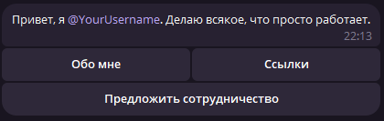

# Telegram Profile Bot

<p align="center">
  <a href="https://telegram.org"></a>
  <a href="https://workers.cloudflare.com/"></a>
  <a href="https://developers.cloudflare.com/kv/"></a>
  <a href="https://grammy.dev"></a>
  <a href="https://www.typescriptlang.org"></a>
  <a href="LICENSE"></a>
</p>

Современный serverless Telegram бот-визитка и персональное интерактивное портфолио со встроенной панелью администратора. Построен на передовом фреймворке grammY и развертывается в бессерверной среде Cloudflare Workers.

Обеспечивает ультрабыстрый отклик по всему миру за счет глобальной сети Cloudflare Edge, надежно сохраняет сессии пользователей в распределенной базе Cloudflare KV и работает полностью бесплатно на базовом тарифе (до 100 000 запросов в день).

<p align="center">
  
</p>

## Основные возможности

* **Интерактивное главное меню**: Удобная кнопочная навигация через нативные инлайн-клавиатуры Telegram.
* **Структурированные разделы портфолио**: Презентационные вкладки «Обо мне», «Проекты» и «Ссылки» с поддержкой динамических ссылок.
* **Форма обратной связи**: Прием предложений о сотрудничестве с защитой от спама (встроенный кулдаун 5 минут между сообщениями).
* **Прямой диалог через Reply**: Администратор может отвечать пользователям прямо из своего личного чата обычным свайпом сообщения (Reply).

### Панель администратора
* `/stats` — просмотр счетчика уникальных пользователей и активности бота.
* `/send <текст>` — мгновенная массовая рассылка по всей базе пользователей с идеальным сохранением форматирования (жирный шрифт, курсив, моноширинный код, ссылки и медиа).
* `/ban <ID>` — моментальная блокировка спамеров и нежелательных пользователей.
* `/unban <ID>` — снятие ограничений с пользователя по его Telegram ID.

## Быстрый старт

### 1. Клонирование и установка зависимостей
```bash
git clone https://github.com/KreziBro/tg-profile-bot.git
cd tg-profile-bot
npm install
```

### 2. Создание KV Namespace
Создайте хранилище сессий в аккаунте Cloudflare:
```bash
npx wrangler kv namespace create BOT_SESSIONS
```
Скопируйте сгенерированный `id` из консоли и добавьте его в файл `wrangler.toml`:
```toml
[[kv_namespaces]]
binding = "BOT_SESSIONS"
id = "ВАШ_СКОПИРОВАННЫЙ_ID"
```

### 3. Настройка параметров бота
В файле `src/index.ts` укажите свои данные:
* `ADMIN_ID`: ваш числовой Telegram ID (можно узнать через бота [@userinfobot](https://t.me/userinfobot)).
* `mainText`: приветственный текст главного меню.
* `projectsMenu` и `linksMenu`: ссылки на ваши проекты, соцсети и портфолио.

### 4. Установка токена бота
Безопасно сохраните секретный токен Telegram бота:
```bash
npx wrangler secret put BOT_TOKEN
```

### 5. Деплой в Cloudflare
```bash
npx wrangler deploy
```

### 6. Регистрация Webhook
Активируйте получение сообщений через вебхук, открыв в браузере URL (заменив плейсхолдеры на ваш токен и адрес задеплоенного воркера):
```text
https://api.telegram.org/bot<ВАШ_БОТ_ТОКЕН>/setWebhook?url=<URL_ИЗ_ДЕПЛОЯ_WRANGLER>
```

## Стек технологий

* **Среда выполнения**: [Cloudflare Workers](https://workers.cloudflare.com/)
* **Хранилище ключ-значение**: [Cloudflare KV](https://developers.cloudflare.com/kv/)
* **Фреймворк**: [grammY](https://grammy.dev/)
* **Язык разработки**: TypeScript

## Сообщество и поддержка

* Официальный Telegram канал разработчика: https://t.me/KreziBro_dev
* Поддержать развитие проекта на платформе Ko-fi: https://ko-fi.com/krejzibro

## Лицензия

Распространяется под лицензией MIT. Подробности в файле [LICENSE](LICENSE).
